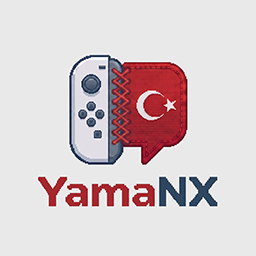
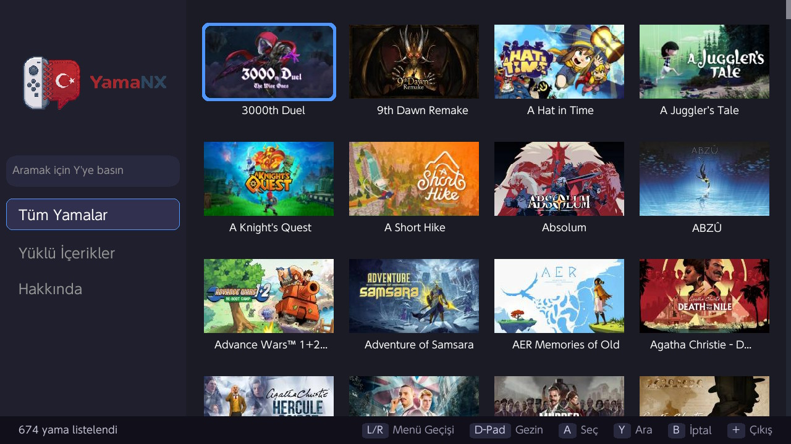
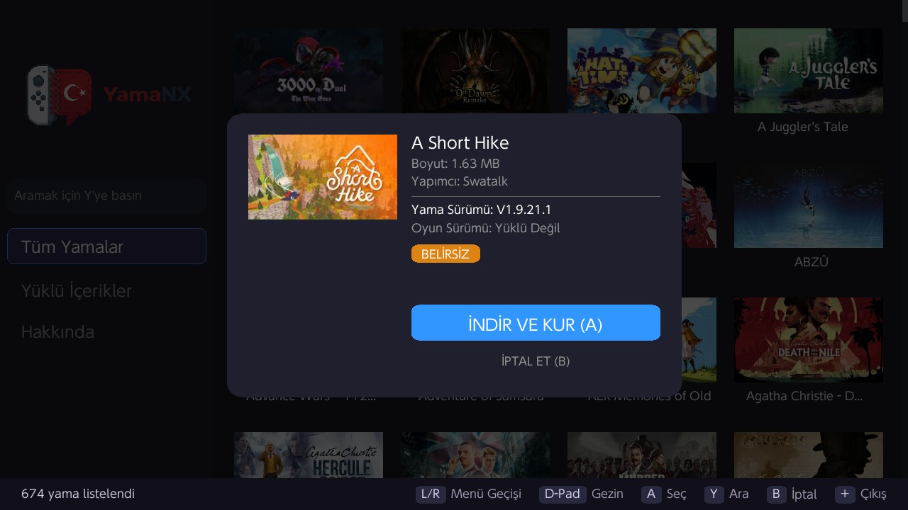
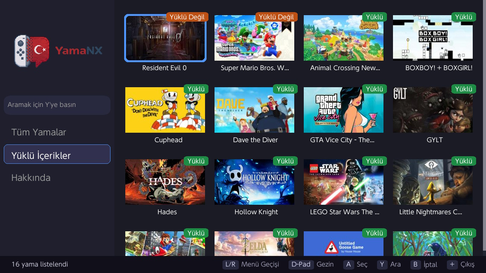
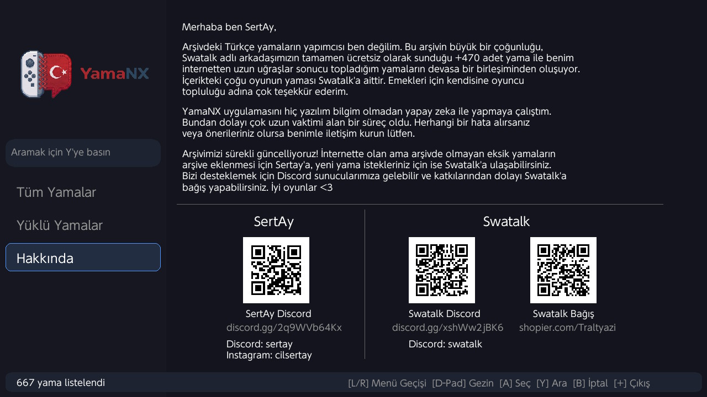
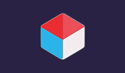

#      YamaNX - Nintendo Switch Türkçe Yama Yükleyicisi

<p align="center">
  
  <br>
  <i>Nintendo Switch için oyunlarınızı Türkçeleştirmenin en kolay yolu!</i>
</p>

---

## 📸 Uygulama Ekran Görüntüleri

<p align="center">
  
  
  <br><br>
  
  
</p>

---

## 📖 Proje Hakkında ve Geliştirici Notu

Merhaba, ben SertAy. 

YamaNX uygulamasını, daha önce hiçbir yazılım tecrübem olmadan tamamen yapay zeka desteğiyle sıfırdan geliştirmeye çalıştım. Bu nedenle ortaya çıkması uzun vaktimi alan, bolca emek içeren bir süreç oldu. Uygulamayı kullanırken herhangi bir hatayla karşılaşırsanız veya geliştirilmesi yönünde önerileriniz olursa lütfen benimle iletişim kurmaktan çekinmeyin.

## ✨ Özellikler

- **Özel Geliştirilmiş Arayüz (SDL2)**: SDL2 ile tasarlanmış ultra hızlı, akıcı, modern ve özelleştirilebilir bir Switch arayüzü. Joy-Con ve Dokunmatik Ekran ile kusursuz çalışır.
- **Otomatik Kurulum**: Seçtiğiniz oyunun yamasını tek tıkla indirir ve SD kartınızdaki doğru klasöre otomatik olarak çıkartır.
- **Dinamik Veri Çekme**: Yamalar sürekli güncel kalacak şekilde çevrimiçi olarak listelenir.
- **Arama ve Filtreleme**: Entegre Switch klavyesi desteği ile devasa arşiv içinde istediğiniz oyunu anında arayıp bulabilirsiniz.
- **Hızlı Erişim**: Hakkında sayfası sayesinde Bağış ve Discord gibi sayısız geliştirici QR koduna tek bir yerden saniyeler içinde ulaşın.

---

## 🚀 Kurulum ve Kullanım

### 1. Yöntem: Homebrew App Store (Otomatik Kurulum)
Uygulamayı doğrudan Switch üzerinden **HB App Store** aracılığıyla indirip kurabilirsiniz.

<p align="center">
  <a href="https://hb-app.store/switch/YamaNXTurkishPatcher">
    
    <br>
    <b>HB Store İndirme Linki</b>
  </a>
</p>

---

### 2. Yöntem: Manuel Kurulum
Uygulamayı bilgisayarınız üzerinden indirip SD kartınıza atarak kurabilirsiniz.

1. [Releases](../../releases) sayfasından en güncel `YamaNX.nro` dosyasını indirin.
2. SD kartınızdaki `switch/` klasörünün içine bu dosyayı atın. *(Eğer klasör yoksa oluşturun: `SD:/switch`)*
3. Switch üzerinden **Homebrew Menu**'ye (hbmenu) girip YamaNX uygulamasını çalıştırın.

💡 **Önemli Not:**
Nintendo Switch üzerinden doğrudan büyük boyutlu yama dosyalarını indirmek, konsolun Wi-Fi hız limitleri nedeniyle bazen uzun sürebilir. Daha hızlı bir alternatif olarak; **Benim ve Swatalk'ın Discord sunucusuna** katılıp yamaları bilgisayarınıza indirebilir ve bir Type-C kablo yardımıyla Switch'inize manuel olarak kurabilirsiniz.

**YamaNX Manifest Oluşturucu Kullanımı**

Büyük boyutlu yamaları bilgisayardan indirip SD kartınıza elinizle attığınızda, YamaNX o yamayı kendisi indirmediği için yüklü olduğunu fark edemez ve uygulamada "Yüklü Değil" yazar.
Bunu düzeltmek için:
YamaNX_Manifest_Oluşturucu.bat dosyasını PC'deki yama klasörünün (0100X...) içine atıp çift tıklayın.
İşlem bitince klasörün içinde oluşan YamaNX_manifest.txt belgesiyle birlikte yamanızı Switch'inize kopyalayın.)

---

## 🗄️ Yama Arşivi Hakkında

Yamaların yapımcısı ben değilim. Arşivde; Swatalk'ın 470'ten fazla ücretsiz yaması ile Soner Çakır, Sinnerclown, Profesör Pikachu, Dede00, emre, davetsiz57 gibi pek çok çevirmen arkadaşın internetten derlediğim çalışmaları yer alıyor. Tespit edebildiğim tüm isimleri oyun seçim ekranına ekledim.

Yama çevirmenlerinin muazzam emekleri için kendilerine oyuncu topluluğu adına çok teşekkür ederim.

---

## 🖥️ PC Emülatör Versiyonu

Çok fazla talep olduğundan dolayı PC'deki emülatörler için .nro uygulamasını exe olarak derledim. Ryujinx, Yuzu, Citron ve Eden'ı destekliyor. [YamaNX.PC.exe'yi](../../releases) kurarak direkt kullanabilirsiniz. Ryujinx'te test edildi ve şuan çalışıyor gibi duruyor.

---

## 📱 YamaNX Android Versiyonu

Android cihazlar için APK formatını derledim. Eden emülatörüyle uyumlu çalışıyor. Sadece YamaNX.apk dosyasını cihazınıza kurmanız yeterli.

---

## 🔗 İletişim ve Destek

### 🛡️ SertAy (YamaNX Geliştiricisi)
*Uygulama hataları ve arşivdeki eksik yamaların eklenmesi için:*

| Linkler | QR Kod |
| :--- | :--- |
| **SertAy Tüm Linkler:** [Linktree Sayfam](https://linktr.ee/yamanx) | <a href="https://linktr.ee/yamanx"></a> |

---

### 👑 Swatalk (Yama Çevirmeni)
*Yeni yama istekleri ve arşive destek olmak için:*

| Linkler | QR Kodlar |
| :--- | :--- |
| **Discord Sunucusu:** [Katılmak İçin Tıklayın](https://discord.com/invite/xshWw2jBK6) | <a href="https://discord.com/invite/xshWw2jBK6"></a> |
| **Destek:** [Destek Olmak İçin Tıklayın](https://www.shopier.com/Traltyazi) | <a href="https://www.shopier.com/Traltyazi"></a> |

---

### 👑 Soner Çakır (Yama Çevirmeni)
| Linkler | QR Kod |
| :--- | :--- |
| **Discord Sunucusu:** [Katılmak İçin Tıklayın](https://discord.com/invite/tB93ZUsRYE) | <a href="https://discord.com/invite/tB93ZUsRYE"></a> |

---

### 👑 SinnerClown Çeviri
| Linkler | QR Kodlar |
| :--- | :--- |
| **Discord Sunucusu:** [Katılmak İçin Tıklayın](https://discord.com/invite/nApvcT6Tt6) | <a href="https://discord.com/invite/nApvcT6Tt6"></a> |
| **Web Sitesi:** [Siteyi Ziyaret Et](https://sinnerclownceviri.net/forumlar/nintendo-tuerkce-yama.74/) | <a href="https://sinnerclownceviri.net/forumlar/nintendo-tuerkce-yama.74/"></a> |

## 🛠️ Kaynak Koddan Derleme (Building from Source)

Projeyi derlemek için **devkitPro** (devkitA64, libnx) ve aşağıdaki switch portlib kütüphaneleri gereklidir:
```bash
dkp-pacman -S switch-sdl2 switch-sdl2_gfx switch-sdl2_image switch-sdl2_ttf switch-libarchive switch-curl switch-mbedtls switch-zlib
```

Derleme komutu:
```bash
make
```

### 🔒 TLS / SSL Güvenlik Notu
Uygulama içi güncelleyici varsayılan olarak dahili kök sertifika deposu olmaksızın SSL doğrulamasını devre dışı bırakır (`CURLOPT_SSL_VERIFYPEER, 0L`). Güvenli bir CA sertifika demetiyle derlemek için `UPD_CA_BUNDLE` bayrağı ile sertifika yolu verilebilir (örn: `-DUPD_CA_BUNDLE=\"sdmc:/switch/cacert.pem\"`).

<br>
<p align="center">İyi oyunlar! &lt;3</p>


---

## 🍎 iOS / iPadOS Emülatör Versiyonu (MeloNX Edition)

iPhone ve iPad cihazlardaki **MeloNX** emülatörü için [YamaNX.ipa](../../releases) dosyasını yayınladım. Uygulamayı aşağıdaki adımları izleyerek kolayca kurup kullanabilirsiniz:

### 1. Uygulamayı Kurma *(MeloNX'i Hangi Araçla Kurduysanız Onunla Kurun)*
1. [Releases](../../releases) sayfasından en güncel **`YamaNX.ipa`** dosyasını iPhone veya iPad'inize indirin.
2. Kullandığınız araca göre kurulumu tamamlayın:
   - **SideStore / AltStore:** İndirdiğiniz `YamaNX.ipa` dosyasına dokunun → **Paylaş** → **SideStore** (veya AltStore) ile açın ve kurulumun bitmesini bekleyin. *(Ücretsiz Apple ID'deki 3 uygulama sınırınız doluysa aşağıdaki LiveContainer yöntemini kullanın.)*
   - **LiveContainer:** LiveContainer'ı açın → sağ üstteki **`+`** butonundan `YamaNX.ipa` dosyasını ekleyin. *(Manuel klasör seçiciyi kullanacaksanız LiveContainer içinde **YamaNX ikonuna basılı tutun → Settings → `Fix File Picker`** seçeneğini açın.)*
   - **Bilgisayar Üzerinden (Sideloadly):** Bilgisayarda [Sideloadly](https://sideloadly.io/) programını açın, `YamaNX.ipa` dosyasını seçip **Start** butonuna basın.
   - **TrollStore *(Uyumlu iOS sürümlerinde)*:** `YamaNX.ipa` dosyasını TrollStore ile açıp doğrudan **Install**'a basın.

### 2. MeloNX Klasörünü Bağlama (İlk Açılış)
- **Standart Kurulum (SideStore / AltStore / Sideloadly / TrollStore):**
  1. **YamaNX**'i açın ve **Ayarlar** sekmesine girin.
  2. **MeloNX Klasörünü Seç** butonuna basın.
  3. Açılan Dosyalar ekranında **iPhone'umda / iPad'imde → MeloNX** *(veya `MeloNX → mods`)* klasörünün **içine girin** ve sağ üstteki **Aç** butonuna dokunun.
- **LiveContainer Kullanıcıları İçin Tek Tıkla Bağlama:**
  1. **YamaNX → Ayarlar** sekmesine girin.
  2. **Otomatik Bul (LiveContainer)** butonuna dokunun. YamaNX, LiveContainer içindeki MeloNX veri klasörünü otomatik olarak tespit edip bağlayacaktır.

### 3. Türkçe Yama Kurma ve MeloNX'te Etkinleştirme
1. YamaNX'te **Yamalar** sekmesinden istediğiniz oyunu seçip **"MeloNX'e Kur"** butonuna dokunun.
2. İndirme ve çıkartma işlemi tamamlandığında yama, MeloNX'in doğrudan mod olarak tanıdığı `MeloNX/mods/contents/<TitleID>/Turkce_Yama/romfs` dizinine kurulur.
3. **MeloNX** emülatörünü açın, **oyununuzun üstüne basılı tutun → `Mods` (Mod Yönetimi)** seçeneğine dokunun:
   - Listede **`Turkce_Yama`** modunun göründüğünü ve **işaretli (aktif)** olduğunu doğrulayın.
   - *(Eğer kullandığınız MeloNX sürümünde mod klasörünü manuel göstermeniz istenirse, aynı menüden `MeloNX/mods/contents/<TitleID>/Turkce_Yama` klasörünü seçmeniz yeterlidir.)*
